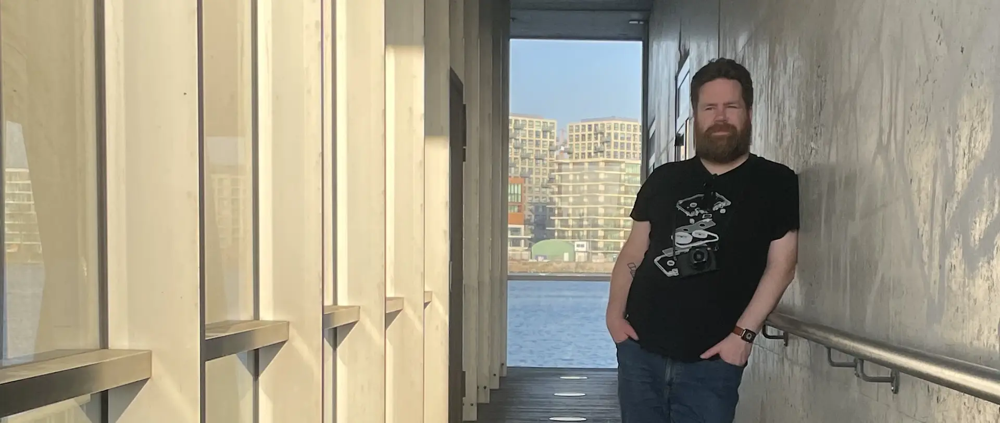

# About me

Hi there! My name is **Kevin Renskers**, and I'm a product-minded senior software engineer who loves the logic that makes software tick: APIs and data models on the backend, authentication, data loading, and form validation on the frontend. Nothing beats that "eureka" feeling of cracking a complex problem in understandable code that still makes sense a year later.

I created my first website in 2000, and got my first job as a PHP developer in 2001. In 2009 I switched to Python and Django, and in 2010 I created my first iOS app. In 2023 I shifted my focus from mostly iOS work back to the open web.

I built [Critical Notes](https://www.critical-notes.com) and [RSS Filter](https://rssfilter.com), I maintain a bunch of [open source projects](/open-source/), and I'm a member of the [Django Software Foundation](https://www.djangoproject.com/foundation/).

My hobbies and interests include playing [PC games](/games/), playing Dungeons & Dragons, watching [tv shows](/shows/), cooking, [photography](/photos/) and architecture. I choose cats over dogs, tea over coffee, and winter over summer. I've lived in Iceland for almost four years, and my favorite foods are ramen, hamburgers, tacos, and Thai.

## Hire me

I've worked as a fully remote developer since 2016, for international clients such as CBS, Last.fm, Sentry, WeTransfer, Unilever, and Emmy and Oscar winner Sound Radix.

I care deeply about clean architecture, code quality, testing, and long-term maintainability. I value pragmatic solutions that balance clarity and performance, and I'm comfortable moving between backend and frontend in the same day.

The tools matter less than the judgment. I happen to work most in Python, TypeScript, and Swift, but what I really bring is the ability to make good technical and product decisions across the whole stack.

### My philosophy: keep it simple

Over my 25 years of experience, [I've learned that the best solution is often the simplest one](/articles/2025/25-years-chasing-simplicity/). I believe in building robust, maintainable software by avoiding unnecessary complexity. Or as I like to say: "A good app is like a mechanical watch. Lots of moving parts all working together to create a beautiful and simple interface."

The best moments in this work are the "eureka" ones: a complex problem cracked with a simple solution, in code that still makes sense a year later. Left unchecked, complexity will always creep in, and you have to actively seek out and defend simplicity.

### What clients say

Michael Hodges, CTO at Skippit:

> Kevin is a highly skilled software engineer with a wide breadth of experience allowing him to work across the product sphere. His insight and talent proved invaluable when building our team and product. **He has an exceptional understanding of product development and design** and keeps the rest of the team focused on the user experience. Kevin is a thought leader and someone I wouldn't hesitate to work with again.

Bert Verstappen, Project Manager at Tessa (a Unilever project):

> From the moment he joined our development team **the quality of the code base increased quickly and our release cycles shortened significantly.** Kevin also has a healthy knowledge of UX and UI, which made me and the team always consider his valuable input. Besides being a solid rock in your team, Kevin is also just a super nice and pleasant guy.

Dan Raviv, CTO at Sound Radix:

> Kevin is the most professional full-stack web developer I’ve worked with. It’s very hard to find engineers who take pride in their craft and are also able to take end-to-end project ownership; Kevin did just that at Sound Radix and reworked our entire website, **improving the UX as well as internals beyond recognition**. I had complete confidence in Kevin to handle any technical challenge on his own.

### Ethics and turn-offs

I will not work on anything related to the promotion of fossil fuels, gambling, tobacco, alcohol, firearms, bitcoin, or blockchains.

I do not use PHP, Wordpress, Windows, or React, and have no interest in doing so.

### Remote only

I work fully remote from my own office in Winterswijk, the Netherlands. I work four days a week for clients, with one day a week reserved for open source work and side projects.

### Let's work together!

